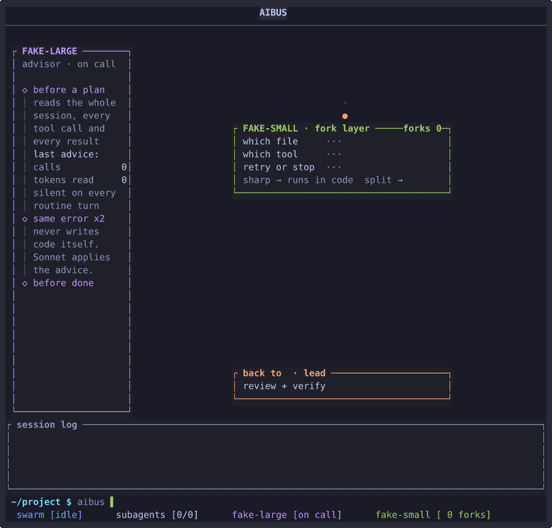

A terminal app for running AI agents with sub-agents, an advisor and continuity across sessions. Rust, ratatui, rataflow, crossterm.



That is the dashboard on the built-in fake provider, so no account or network is involved: the lead makes a plan, the advisor rail on the left comments on it, the router answers a small decision, three workers take a card each, and the last two seconds are the mouse (hover, click, right click). The recording is made by a script, see [docs/media/README.md](docs/media/README.md).

What it does, in one paragraph: a lead agent talks to you and delegates to sub-agents defined as Markdown files with YAML frontmatter (project or user scope, tool allow-lists, model per agent, background or foreground, resumable). An advisor reads the whole session and speaks only at checkpoints. A router answers small decisions with a cheap model and escalates the uncertain ones. Ledgers, handoffs and memory carry state from one session to the next... compound, don't compact. Several providers and several accounts per provider, credentials in the OS keychain. The whole application state is one Causl graph, so every event is one atomic commit, the commit log is the audit trail, and a snapshot is the session save.

The spec is at [docs/SPEC.md](docs/SPEC.md) and the contested decisions are in [docs/DECISIONS.md](docs/DECISIONS.md).

## Install

Releases are built for macOS (arm64, x86_64), Linux (x86_64 musl and glibc, aarch64) and Windows (x86_64). Every installer checks the SHA-256 of the archive against the release's `SHA256SUMS` before it unpacks anything.

macOS and Linux:

```sh
curl -fsSL https://raw.githubusercontent.com/spdrman/aibus/main/install.sh | sh
```

Windows (PowerShell 5.1 or 7):

```powershell
irm https://raw.githubusercontent.com/spdrman/aibus/main/install.ps1 | iex
```

Homebrew (macOS and Linux), this repository is the tap:

```sh
brew tap spdrman/aibus https://github.com/spdrman/aibus && brew install spdrman/aibus/aibus
```

What the installers do:

* `install.sh` puts the binary in `$HOME/.local/bin` (no `sudo`). On Linux x86_64 it installs the musl build, which runs on any distro; `--gnu` asks for the glibc build, and aarch64 only has the glibc one. It uses `curl` or `wget`, and if `cosign` is on your `PATH` it also verifies the signature bundle (otherwise it says it skipped that). It never edits a shell startup file unless you pass `--modify-path`, and prints the `export PATH=...` line when the directory is not on your `PATH`.
* `install.ps1` puts `aibus.exe` in `%LOCALAPPDATA%\Programs\aibus\bin` and adds that directory to your user `PATH`. It checks the SHA-256 only (no cosign step). There is no arm64 build, so on Windows on Arm it installs the x86_64 one.
* Both read the same knobs: `AIBUS_VERSION` (for example `0.1.0`, default the latest release), `AIBUS_INSTALL_DIR`, and `AIBUS_NO_MODIFY_PATH=1`.

```sh
# a specific version, somewhere else
curl -fsSL https://raw.githubusercontent.com/spdrman/aibus/main/install.sh | AIBUS_VERSION=0.1.0 AIBUS_INSTALL_DIR=/opt/aibus/bin sh
```

### First checks

```sh
aibus version    # the release tag and the commit it was built from
aibus doctor     # the install and the config: keychain backend, config files, anything off
```

With no account configured, `aibus` starts on the built-in fake provider. Add a real one with `aibus account add`, see [docs/PROVIDERS.md](docs/PROVIDERS.md).

### Author workflows from an MCP client

`aibus mcp` is an MCP server, so an editor or chat app can read your workflows and check a draft. Three lines of config in the client:

```json
{"command": "aibus", "args": ["mcp"]}
```

By default it is read-only: it lists and explains workflows, validates a draft against your real agents, shows what a workflow would do for an input without calling a model, and serves the workflow schema and an authoring prompt. `--allow write` adds creating and updating workflows (a gate needs `--allow gates` as well); a later flag adds running them (`--allow run`). Setup for a few clients, the tool list and what the server logs are in [docs/MCP.md](docs/MCP.md).

### Upgrade

Run the installer again (it replaces the binary in place), or `brew upgrade aibus`.

### Uninstall

```sh
curl -fsSL https://raw.githubusercontent.com/spdrman/aibus/main/install.sh | sh -s -- --uninstall
brew uninstall aibus && brew untap spdrman/aibus
```

On Windows, run the script as a script block with `-Uninstall`:

```powershell
& ([scriptblock]::Create((irm https://raw.githubusercontent.com/spdrman/aibus/main/install.ps1))) -Uninstall
```

That removes the binary (and the `PATH` entry on Windows). Your config, session data and keychain entries stay: remove the accounts with `aibus account remove <name>` first if you want them gone.

### Manual download and verification

Each release has `aibus-<target>.tar.gz` (`.zip` on Windows), `SHA256SUMS`, `aibus.cdx.json` (the SBOM), and a `.sigstore.json` bundle next to every file. Targets: `aarch64-apple-darwin`, `x86_64-apple-darwin`, `x86_64-unknown-linux-musl`, `x86_64-unknown-linux-gnu`, `aarch64-unknown-linux-gnu`, `x86_64-pc-windows-msvc`.

```sh
sha256sum -c --ignore-missing SHA256SUMS      # shasum -a 256 -c on macOS
cosign verify-blob --bundle aibus-<target>.tar.gz.sigstore.json \
  --certificate-identity https://github.com/spdrman/aibus/.github/workflows/release.yml@refs/heads/release \
  --certificate-oidc-issuer https://token.actions.githubusercontent.com \
  aibus-<target>.tar.gz
tar -xzf aibus-<target>.tar.gz && ./aibus-<target>/aibus version
```

### Build from source

You need the Rust version in [rust-toolchain.toml](rust-toolchain.toml) (1.89, the MSRV), which `rustup` picks up by itself.

```sh
git clone https://github.com/spdrman/aibus && cd aibus
cargo build --release --locked
target/release/aibus version
```

### What is not proven

* No real provider has been exercised end to end: the tests and the demo run on the fake provider, and the live provider run is a separate nightly job.
* Windows is unverified. The binary is built, but nobody has run it on a Windows machine yet (see [docs/RELEASE.md](docs/RELEASE.md)), and the `PATH` change in `install.ps1` is the part the container tests could not exercise.
* The release pipeline and the installers have only run against fake releases in containers until the first real release is cut.
* OAuth sign-in and the Bedrock and Vertex transports are in the code, but not usable yet: no provider offers an OAuth login, and `auth = "sigv4"` or `"gcloud"` cannot be selected from the config.
* Only the Linux and macOS terminals I own have been tried by eye; the rest of the checklist in [docs/RELEASE.md](docs/RELEASE.md) is open.

## Layout

```
crates/aibus                      the binary
crates/aibus-core                 engine: definitions, runs, tools, hooks, continuity
crates/aibus-graph                Causl contract, mini engine, causl-engine-core host
crates/aibus-provider             Provider trait, accounts, fake provider
crates/aibus-provider-anthropic
crates/aibus-provider-openai      OpenAI, Kimi/Moonshot and OpenAI-compatible dialects
crates/aibus-tui                  ratatui widgets and view model
crates/aibus-testkit
```

## Licence

MIT, see [LICENSE](LICENSE).
