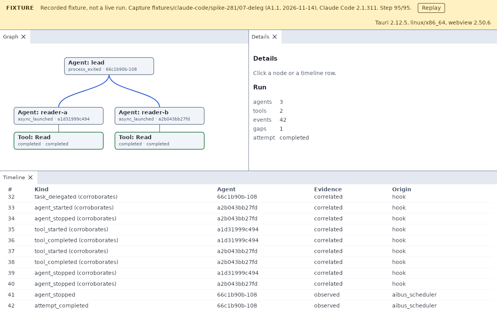
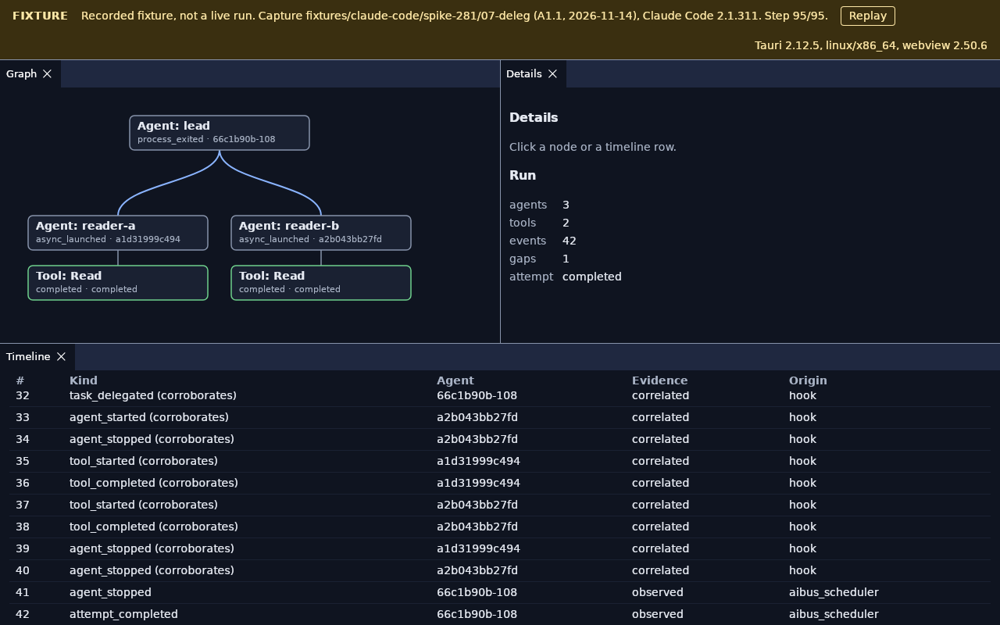

# B1.1 spike: Tauri desktop shell and Claude Code trace (#304)

This is the spike for #304, the first slice of EPIC B (#303). I ran it on 2026-11-22, Linux only, in
docker. B1.5 (#308) reviews it and confirms or overturns the go/no-go below... so everything here is
either something I saw in a run (with the command to repeat it), or marked as unverified.

## Recommendation: GO-WITH-CONDITIONS

Tauri 2 + Vite + React works for aibus on Linux, end to end, with the existing Rust core and no
change to how the core builds. The path the acceptance criteria ask for runs for real:

1. **Provider events.** The A1.1 capture of a real Claude Code 2.1.311 run
   (`fixtures/claude-code/spike-281/07-deleg`: a lead, two native subagents `reader-a` and
   `reader-b`, a `Read` call each) is compiled into the host.
2. **Normalised stream.** The host feeds each captured stdout line, then each hook line, through
   `aibus_supervisor::Normalizer`, the same normaliser a live supervised run uses, and projects the
   growing event list with `aibus_trace::project`.
3. **Tauri IPC.** `replay_fixture` streams one `Snapshot` per captured line over a
   `tauri::ipc::Channel`, paced at half the recorded speed (95 steps in about 11 s).
4. **React.** The webview draws the graph (lead, both subagents, their tools, the cross-checked
   delegation edges), the timeline (42 normalised events, observed vs correlated, which ones
   corroborate) and an inspector, in a dockview layout.




Both screenshots are the release build under Xvfb on the NAS, taken 15 s after start (the replay is
done by then).

### Conditions

1. **macOS is unverified.** Nobody has built or opened it on a Mac. The owner steps are in
   [VERIFY-MACOS.md](VERIFY-MACOS.md); B1.5 should not confirm GO until that section exists.
2. **Live data is not wired.** What's on screen is the recorded fixture and says so on every
   snapshot and in the banner. A live run needs the host to tail a `TraceStore` while the supervisor
   writes it, plus a launch command with a fixed argument set. That is Phase 2 run-workspace work
   (docs/DEFERRED.md), and it does not change anything this spike found about the stack.
3. **Keep the host crate outside the workspace.** tauri 2.12 needs Rust 1.90; the workspace stays at
   1.89 until someone decides to move it.
4. **The numbers below are observations, not benchmarks.** One run each, on a shared host, under
   Xvfb with software rendering. A proper baseline goes through the Mercury bench queue once Phase 2
   has a workload worth timing.

## What I picked, and why

| Choice | Pick | Why |
|---|---|---|
| Shell | Tauri `2.12.5`, tauri-build `2.7.4` (exact pins, lockfile in `desktop/src-tauri/Cargo.lock`) | The 2.12 line the issue decided on, at the newest patch older than four weeks |
| Host crate | `desktop/src-tauri` (`aibus-desktop`), its own `[workspace]`, `resolver = "3"`, `rust-toolchain.toml` at 1.90 | Same pattern as `crates/aibus-graph-causl`. Resolver 3 keeps dependency picks inside 1.90 |
| Link to the core | path deps on `aibus-supervisor` and `aibus-trace` | The host uses the real normaliser and projection, not a copy. The only core change is `Serialize` on the projection types |
| Frontend | React 19.2.0, TypeScript 5.9.3, Vite 7.1.12, Vitest 4.0.8 | Same versions as `shared-ui` (#305, PR #374), so #307 can swap in the shared primitives without a version move |
| Layout | `dockview-react` 8.8.3 (MIT, no runtime deps beyond `dockview`/`dockview-core`) | The issue said try dockview first. It worked: three panels, tabs, sashes, theming through CSS variables. I didn't need the `react-resizable-panels` fallback |
| npm | `.npmrc` `ignore-scripts=true`, `npm ci` from the lockfile | No install scripts run, same as `shared-ui` |

dockview's package moved its React bindings to `dockview-react` in v8; `dockview` alone has no
`DockviewReact` export any more. Worth knowing for #307.

## Security boundary

- The webview can call exactly two commands, `replay_fixture` and `stack_info`. `build.rs` lists
  them in the app manifest and `capabilities/default.json` grants them by name, so a command added
  later is not callable until someone grants it on purpose. No core default permissions are granted.
- No shell, fs, opener, http or dialog plugin is installed. There's no command that takes a path, a
  command string, a provider name or an argv.
- `replay_fixture` takes only the channel. The fixture is compiled in, so the webview can't point the
  host at a file.
- The IPC payload holds the projection only: ids, roles, kinds, statuses, evidence positions, usage
  metrics. A host test (`nothing_credential_or_raw_crosses_the_boundary`) fails if the payload
  contains credential names, the CLI path, the prompt text or a raw vendor line.
- CSP is `default-src 'self'`, `script-src 'self'`, no remote origins. `'unsafe-inline'` is on
  `style-src` only, for dockview's inline sizing.
- Live and fixture data are told apart in the type (`Provenance` has one variant, `fixture`) and on
  screen (the banner). There is no live button and no fake provider login anywhere.

## Toolchain compatibility

| Item | What I found |
|---|---|
| Rust MSRV | Host crate: 1.90 (tauri 2.12.5 and tauri-build 2.7.4 declare `rust-version = 1.90`). Workspace: unchanged at 1.89 |
| Linux build deps | Debian bookworm: `libwebkit2gtk-4.1-dev libgtk-3-dev librsvg2-dev libssl-dev libayatana-appindicator3-dev` (see `desktop/Dockerfile.linux`) |
| WebKitGTK | 4.1 ABI, `2.50.6-1~deb12u2` from bookworm-security. The app reports `webview 2.50.6` via `tauri::webview_version()` |
| Node | 22 (the image), `engines` says 20+ |
| Tauri CLI | `@tauri-apps/cli` 2.12.4 as a dev dependency; `npx tauri build --no-bundle -- --locked` |
| macOS | Unverified. WKWebView needs no package; see VERIFY-MACOS.md |
| Windows | Out of scope (decided on #304) |

## Linux webview notes

- **Sandbox off in the container.** WebKitGTK's bubblewrap sandbox can't create user namespaces in a
  plain container, so `linux.sh run` sets `WEBKIT_DISABLE_SANDBOX_THIS_IS_DANGEROUS=1`. That's a
  container limitation. On a real desktop the sandbox stays on, and nothing in the app turns it off.
- **No GPU.** `WEBKIT_DISABLE_COMPOSITING_MODE=1` and `LIBGL_ALWAYS_SOFTWARE=1` under Xvfb. Rendering
  was correct; I didn't test a GPU path.
- **Dark mode follows GTK.** With `GTK_THEME=Adwaita:dark` WebKitGTK reports
  `prefers-color-scheme: dark` and the page switches, so no app code is needed for it.
- **Session bus.** I run the app under `dbus-run-session` so WebKitGTK has a session bus, as it
  would on a desktop. I didn't try it without one.
- **Three processes.** The app, `WebKitWebProcess` and `WebKitNetworkProcess`. The web process is
  the biggest of the three.

## Measurements (Linux, observations)

All from `sh linux.sh build` and `sh linux.sh run` in `aibus-desktop-linux` on the NAS (native
x86_64, 6 cpus, container capped at 4 cpus and 6 GB), 2026-11-22. Memory is PSS so pages shared
between the processes are counted once.

| What | Light run | Dark run |
|---|---|---|
| Window mapped after start | 329 ms | 312 ms |
| Peak PSS, app + WebKit + dbus | 259,229 kB | 255,472 kB |
| `aibus-desktop` at t=15 s (RSS / PSS) | 161,104 / 90,979 kB | 161,720 / 90,691 kB |
| `WebKitWebProcess` at t=15 s | 200,304 / 134,508 kB | 199,496 / 132,774 kB |
| `WebKitNetworkProcess` at t=15 s | 61,348 / 29,350 kB | 61,828 / 29,154 kB |
| Mean CPU, t=2..30 s (replay, then idle) | 5.9% of one core | 5.7% of one core |

| Build | Result |
|---|---|
| Release binary (`opt-level = "s"`, LTO, stripped) | 7,421,680 bytes |
| Release build, cold dependencies, 4 cpus | 3 min 57 s |
| Release build after a frontend-only change | 1 min 27 s |
| JS bundle | 629.55 kB (163.86 kB gzip); CSS 145.02 kB (11.71 kB gzip), mostly dockview |

The very first run (before I widened the graph nodes) mapped the window after 1,583 ms, with a cold
page cache; I'd take the sub-second figures as the warm case and the 1.6 s as a cold start.

CPU is near zero once the replay ends (0 or 1 tick a second from t=17 s in the per-second log), so an idle window
costs nothing measurable here.

## How to reproduce

From a checkout, on any x86_64 Linux docker host:

```sh
docker build --platform linux/amd64 -f desktop/Dockerfile.linux -t aibus-desktop-linux desktop
docker run --rm --platform linux/amd64 --cpus 4 --memory 6g \
  -v "$PWD":/src -v aibus-desktop-target:/tmp/target -w /src/desktop \
  aibus-desktop-linux sh linux.sh all
# dark theme run on its own:
docker run --rm --platform linux/amd64 -e GTK_THEME=Adwaita:dark -e OUT=/src/desktop/run-out/dark \
  -v "$PWD":/src -v aibus-desktop-target:/tmp/target -w /src/desktop aibus-desktop-linux sh linux.sh run
```

`linux.sh all` runs the gates (rustfmt, clippy and check on the host crate, `tsc --noEmit`, vitest),
the host crate's tests, the release build, and the Xvfb run that prints the table above and writes
`desktop/run-out/screenshot.png` and `app.log`.

For a real benchmark, run the `run` step through the Mercury bench queue (`bench-queue.sh dh`)
and repeat it; nothing here was timed that way.

## Hosts

- Image build, lockfile generation, release build and both Xvfb runs: the NAS (container only). I
  first tried the image build on MARS, but its docker disk was saturated by other jobs and dpkg sat
  for 20 minutes on one package, so I built on the NAS and loaded the same image on MARS.
- Host crate gates (rustfmt, clippy, check, its tests): MARS at `57eb43a`, then the NAS at the merged
  tip `7154814`. Workspace gate for the `aibus-trace` change: the MARS gate runner at `7154814`.
- macOS: nothing yet.

## Things the next issues need to know

- **Subagent status shows the launch mode.** The projection gives `reader-a`/`reader-b` the status
  `async_launched` even after both stopped, because `AgentNode.status` holds what the delegation
  said. The UI shows it as is. A "stopped" state on the child belongs in the projection (#284's
  area), not in the webview.
- **Snapshots are whole projections.** Fine for 95 steps; a long live run wants deltas or a cap.
- **The golden snapshot** (`desktop/src/test/final-snapshot.json`) is the Rust side's real output,
  checked by a Rust test and loaded by the vitest suite. Regenerate it with
  `AIBUS_BLESS=1 cargo test` in `desktop/src-tauri` whenever the projection changes.
- **Workspaces.** `desktop/src/workspaces/{workflow,run,trace,providers}` exist so each B slice has a
  home. `run` holds the replay source and banner, `trace` the graph, timeline and inspector;
  `workflow` and `providers` are empty stubs.
